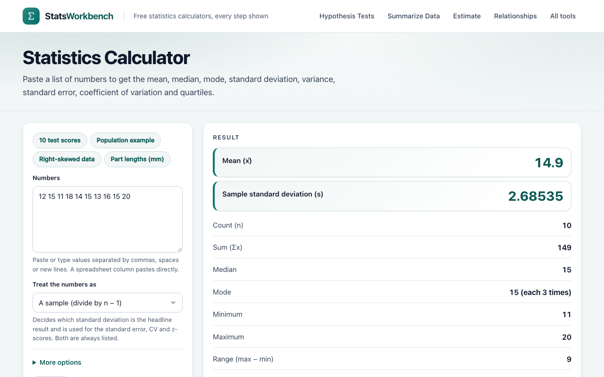
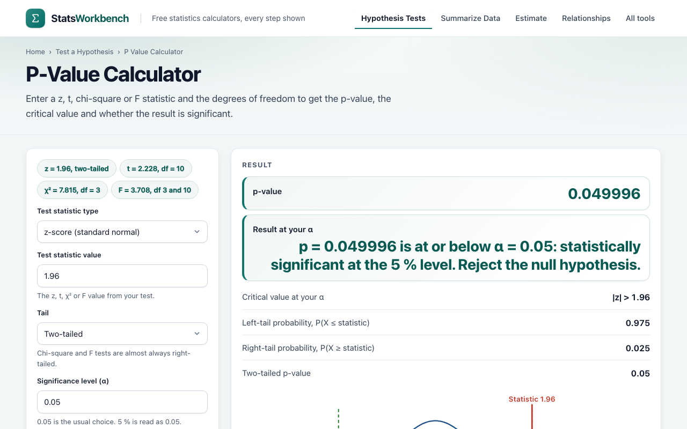

# stats-core

> Zero-dependency statistics for JavaScript: t tests, ANOVA F and Tukey HSD, binomial and Poisson probabilities, power and sample size, least squares.

[](LICENSE)

**Live demo:** this is the calculation code behind the free statistics calculators at [cn8t.com](https://cn8t.com/) (Stats Workbench): [P-value calculator](https://cn8t.com/p-value-calculator/), [t-test calculator](https://cn8t.com/t-test-calculator/), [one-way ANOVA calculator](https://cn8t.com/anova-calculator/), [binomial distribution calculator](https://cn8t.com/binomial-distribution-calculator/) and [standard deviation calculator](https://cn8t.com/standard-deviation-calculator/).



## Why this exists

The calculators on cn8t.com show every formula and every intermediate number, so the maths has to be small, readable and checkable. The library is plain ES modules with no dependencies and no DOM, so it runs in Node 18+ and in any browser. Each function states its source (a textbook, an NIST page, or the R or SciPy routine it follows) in the comment above it.

The test, discrete-distribution, power and matrix functions check their inputs and throw an `Error` with an English message that names the argument (for example `n must be a whole number of at least 2 (got 1)`). The low-level helpers in `stats.js` (such as `mean`, `sampleSD` and the normal/t/F distribution functions) do not throw: they return `NaN` for invalid input, as do mathematically undefined results such as the quantile of a probability outside [0, 1].



## Install

The package is not on npm yet. Until then, clone the repository and import from `src/`:

```js
import { twoSampleT, summarize } from './src/index.js';
```

Once published: `npm install stats-core`.

## Examples

### Welch t test from two samples

```js
import { summarize, twoSampleT } from 'stats-core';

const a = [27.5, 21.0, 19.0, 23.6, 17.0, 17.9, 16.9, 20.1, 21.9, 22.6, 23.1, 19.6, 19.0, 21.7, 21.4];
const b = [27.1, 22.0, 20.8, 23.4, 23.4, 23.5, 25.8, 22.0, 24.8, 20.2, 21.9, 22.1, 22.9, 20.5, 24.4];
const x = summarize(a), y = summarize(b);

const r = twoSampleT({ m1: x.mean, s1: x.sd, n1: x.n, m2: y.mean, s2: y.sd, n2: y.n });
// r.t = -2.4554, r.df = 24.9885, r.p = 0.021378
// 95% CI of the difference: [-3.9841, -0.3492], Cohen's d = -0.8966
```

Pass `pooled: true` for the Student (equal variance) test, `tail: 'greater' | 'less'` for one-sided tests, and `delta0` to test a difference other than zero. `oneSampleT({ mean, sd, n, mu0 })` does the one-sample test (and the paired test when you give it the mean and SD of the differences).

### Distributions and p-values

```js
import { tInv, tSf, normInv, chiSqSf, fSf } from 'stats-core';

tInv(0.975, 10);     // 2.2281  two-sided 95% critical value
tSf(2.2281, 10);     // 0.0250  P(T > t)
normInv(0.975);      // 1.9600
chiSqSf(3.84, 1);    // 0.0500
fSf(4.1, 2, 12);     // 0.0440  the one-way ANOVA p-value for F = 4.1, df 2 and 12
```

### Binomial and Poisson probabilities

```js
import { binomPmf, binomSf, binomTestTwoSided, poisPmf } from 'stats-core';

binomPmf(3, 10, 0.5);                // 0.1172
binomSf(7, 10, 0.5);                 // 0.0547  P(X > 7)
binomTestTwoSided(7, 10, 0.5);       // 0.3438  exact two-sided p-value
binomPmf(1000, 1_000_000, 0.001);    // 0.01262 works for very large n
poisPmf(3, 2);                       // 0.1804
```

### Tukey HSD

```js
import { ptukey, qtukey } from 'stats-core';

ptukey(3.5, 3, 20);     // 0.9441  P(Q <= 3.5) for 3 groups, 20 error df
qtukey(0.95, 3, 20);    // 3.5779  critical value for Tukey intervals at 95%
```

### Power and sample size

```js
import { power, solveN, solveEffect } from 'stats-core';

power('ind', 0.5, 64, 0.05);        // 0.8015  two-sample t test, d = 0.5, 64 per group
solveN('ind', 0.5, 0.8, 0.05);      // 64      smallest n per group for 80% power
solveEffect('one', 30, 0.8, 0.05);  // 0.5292  smallest d detectable with n = 30
```

### Least squares

```js
import { ols } from 'stats-core';

const fit = ols([[1, 1], [1, 2], [1, 3], [1, 4]], [2, 4, 5, 8]);
// fit.beta = [~0, 1.9]  fit.rss = 0.7  fit.xtxInv = (XtX)^-1
```

### Descriptive statistics

```js
import { mean, sampleSD, popSD, quartilesSorted, parseNumberList } from 'stats-core';

const data = [2, 4, 4, 4, 5, 5, 7, 9];
mean(data);                         // 5
popSD(data);                        // 2
sampleSD(data);                     // 2.1381
quartilesSorted(data, 'linear');    // { q1: 4, median: 4.5, q3: 5.5 }
parseNumberList('1, 2 3;x');        // { values: [1, 2, 3], bad: ['x'] }
```

## API and formulas

Every module can also be imported on its own, for example `stats-core/discrete`.

### `stats` (`src/stats.js`)

| Function | What it does |
|---|---|
| `mean(xs)`, `sampleSD(xs)`, `popSD(xs)` | Mean; standard deviation with divisor n-1 (sample) or n (population). |
| `normCdf`, `normSf`, `normPdf`, `normInv`, `normInvSf` | Standard normal distribution. The CDF follows Abramowitz and Stegun 7.1 and the inverse uses Acklam's rational approximation with a refinement step. |
| `lnGamma(x)`, `betaInc(a, b, x)`, `gammaP(a, x)`, `gammaQ(a, x)` | Log-gamma, regularized incomplete beta and gamma functions (continued fractions and series, Numerical Recipes 3rd ed., chapters 6.1 to 6.4). |
| `chiSqCdf`, `chiSqSf`, `chiSqPdf`, `chiSqInv`, `chiSqInvSf` | Chi-square distribution: P(X <= x) = P(k/2, x/2). |
| `tCdf`, `tSf`, `tPdf`, `tInv`, `tInvSf` | Student t distribution through the incomplete beta function. |
| `fCdf`, `fSf`, `fPdf`, `fInv`, `fInvSf` | F distribution: P(F > f) = I(d2/(d2+d1 f); d2/2, d1/2). |
| `medianSorted`, `quantileSorted`, `quartilesSorted` | Quantiles of a sorted array. `QUARTILE_METHODS`: `halves` (median excluded), `tukey` (median included), `nist` (type 6), `linear` (type 7, the R and NumPy default). |
| `parseNumberList(text)`, `parseOne(v)` | Numbers from free text (commas, semicolons, spaces, new lines); the Unicode minus sign is accepted. |
| `D2` | SPC constant d2 for n = 2 to 10, so sigma-hat = mean range / d2. |

### `ttest` (`src/ttest.js`)

| Function | Formula |
|---|---|
| `oneSampleT({ mean, sd, n, mu0, tail, alpha })` | t = (mean - mu0) / (sd / sqrt(n)), df = n - 1, CI = mean +/- t(1-alpha/2, df) * se, d = (mean - mu0) / sd. |
| `twoSampleT({ m1, s1, n1, m2, s2, n2, delta0, pooled, tail, alpha })` | Welch: se = sqrt(s1^2/n1 + s2^2/n2) with Welch-Satterthwaite df. Pooled: sp^2 = ((n1-1) s1^2 + (n2-1) s2^2) / (n1+n2-2), df = n1+n2-2. d = (m1 - m2) / sp. |
| `tPValue(t, df, tail)`, `zPValue(z, normSf, tail)` | `tail` is `'two'`, `'greater'` or `'less'`. |
| `tCritTwo(alpha, df)`, `tCritical(alpha, df, tail)` | Critical values of the t distribution. |
| `summarize(xs)` | `{ n, mean, sd }`. |
| `effectKey(d)` | Cohen's benchmarks: `none` below 0.2, `small` below 0.5, `medium` below 0.8, otherwise `large`. |

### `discrete` (`src/discrete.js`)

| Function | What it does |
|---|---|
| `binomPmf(x, n, p)`, `poisPmf(x, lambda)` | Point probabilities with Loader's saddle-point algorithm (`stirlerr`, `bd0`), the same method as R's `dbinom` and `dpois`, accurate for very large n. |
| `binomRange`, `binomCdf`, `binomSf`, `poisRange`, `poisCdf`, `poisSf` | Range sums that start at the largest term and use the ratio recurrence p(k+1)/p(k) = (n-k)/(k+1) * p/(1-p) (binomial) or lambda/(k+1) (Poisson), so tiny tails keep their relative accuracy. |
| `binomTestTwoSided(x, n, p)` | Sum of P(X = k) over every k with P(X = k) <= P(X = x)(1 + 1e-7); the definition used by R `binom.test` and SciPy `binomtest`. |
| `eventBounds(kind, x, x2, max)` | Turns `eq`, `le`, `lt`, `ge`, `gt` or `between` into an inclusive integer interval. |
| `normalApprox(lo, hi, mu, sigma)` | Normal approximation with continuity correction: Phi((hi + 1/2 - mu)/sigma) - Phi((lo - 1/2 - mu)/sigma). |

### `tukey` (`src/tukey.js`)

`ptukey(q, k, df)` and `qtukey(p, k, df)` are the studentized range distribution used by Tukey HSD. They are a port of R's `ptukey.c`, which implements Copenhaver and Holland (1988) with Gauss-Legendre quadrature, accurate to about 1e-8. The HSD critical difference is qtukey(1 - alpha, k, df) * sqrt(MSE / n).

### `power` (`src/power.js`)

| Function | What it does |
|---|---|
| `nctCdf(x, df, ncp)` | Non-central t distribution, algorithm AS 243 (Lenth 1989). |
| `power(kind, effect, n, alpha, tails)` | `kind` is `'ind'` (two-sample t, n per group, ncp = d sqrt(n/2)), `'one'` (one-sample or paired t, ncp = d sqrt(n)), `'prop'` (two proportions, effect = Cohen's h, normal approximation) or `'corr'` (effect = r, Fisher z with se 1/sqrt(n-3)). |
| `solveN(kind, effect, target, alpha, tails)` | Smallest integer n that reaches the target power. |
| `solveEffect(kind, n, target, alpha, tails)` | Smallest effect size detected with the target power. |
| `cohenH(p1, p2)` | h = 2 asin(sqrt(p1)) - 2 asin(sqrt(p2)). |

### `matrix` (`src/matrix.js`)

`matMul`, `transpose`, `invUpper` and `ols(X, y)`. Least squares is solved with Householder QR rather than by inverting X'X (Golub and Van Loan, section 5.3). `ols` returns `{ ok, beta, rss, xtxInv, rank }`, or `{ ok: false, deficient: j }` when column j is a linear combination of earlier columns.

## Accuracy and tests

```sh
npm test      # node --test, no install needed
```

The tests compare results with reference values that were computed with SciPy, R or NumPy and are written next to each assertion as a comment (for example `stats.ttest_ind(a1, a2, equal_var=False)`), plus hand-checked textbook examples. Relative tolerances are 1e-6 to 1e-9 depending on the function, and the ptukey and qtukey tests use about 1e-8. Values outside the tested ranges have not been checked. If you find a case where a result differs from R or SciPy, please open an issue with the input.

## Contributing

Issues and pull requests are welcome. Keep new code dependency-free, add a test with a reference value and name the source of the algorithm.

## License

MIT. See [LICENSE](LICENSE). Copyright (c) 2026 SKYSEED TECH LLC. Questions: [support@cn8t.com](mailto:support@cn8t.com).

More free statistics tools: [cn8t.com](https://cn8t.com/).
